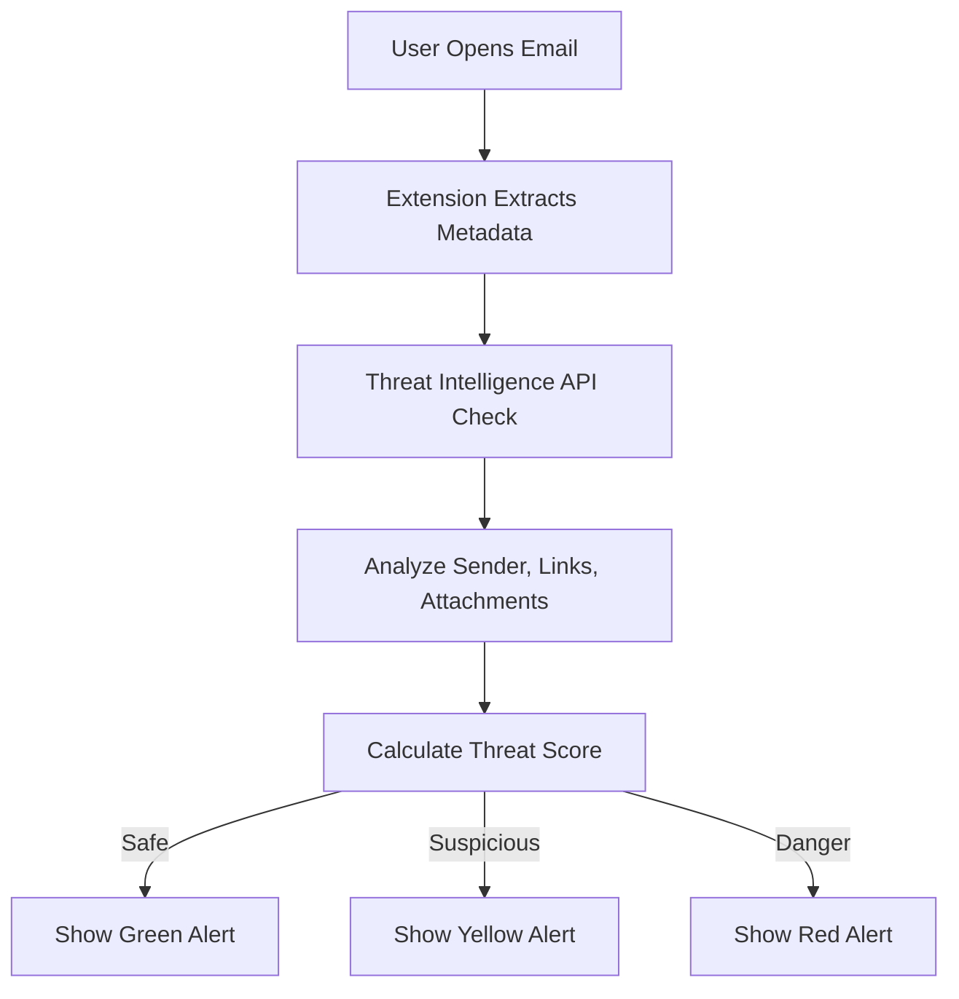

# 📨 Phishing Email Threat Analyzer

[](https://developer.mozilla.org/en-US/docs/Web/JavaScript)
[](#)
[](#)
[](LICENSE)
[](#)

> **"Phishing Email Analysis & Threat Intelligence"** — A browser extension for real-time phishing detection using OSINT and open threat intelligence APIs.

---

## 📜 Overview
Phishing remains one of the **most common and dangerous** cyber threats, often bypassing traditional spam filters.  
This project is a **browser extension** that:
- Extracts **email metadata** (sender, subject, links, attachments)
- Cross-checks with **Threat Intelligence APIs**
- Detects malicious links & attachments
- Provides **instant alerts** in a privacy-focused manner

---

## 🎯 Features
- **Real-Time Analysis** — Detects phishing indicators instantly
- **Link & Attachment Scanning** — Identifies malicious/suspicious content
- **OSINT Integration** — Uses open APIs (VirusTotal, AbuseIPdb, etc.)
- **Privacy Focused** — Minimal data sharing, local processing
- **Threat Scoring** — Classifies emails as Safe, Suspicious, or Dangerous
- **Detailed Reports** — Shows sender spoofing, domain age, and reputation

---

## 📂 Project Structure
```bash
Phishing-Email-Threat-Analyzer/
│
├── popup.html # Main extension popup UI
├── popup.js # Logic for analysis, API calls
├── style.css # Extension styling
├── manifest.json # Chrome/Edge extension manifest
├── README.md # Documentation
└── assets/ # Icons & images
```
---

## ⚙️ Installation
### 1️⃣ Clone the Repository
```bash
git clone https://github.com/<your-username>/Phishing-Email-Threat-Analyzer.git
cd Phishing-Email-Threat-Analyzer
```
### 2️⃣ Load the Extension in Chrome/Edge
1. Open chrome://extensions/

2. Enable Developer Mode

3. Click Load unpacked

4. Select the project folder

--- 

## 🌐 Host Live for Portfolio (GitHub Pages)
You can showcase this project with a live portfolio page:

1. Push this repository to GitHub
2. Go to **Settings → Pages**
3. Under **Build and deployment**, choose:
   - **Source:** Deploy from a branch  
   - **Branch:** `main` (or your default branch), folder `/ (root)`
4. Save and wait for deployment
5. Your live link will be:
   - `https://akhileshpalve89.github.io/Phishing-Email-Analyzer/`

> Note: this live page is a project showcase. The extension itself still runs by loading it in browser extensions.

---

## 🌍 Host Live on Netlify
You can deploy the same portfolio page (`index.html`) on Netlify:

1. Sign in to Netlify
2. Click **Add new site** → **Import an existing project**
3. Connect GitHub and select this repository
4. Netlify will auto-detect static hosting (the repo now includes `netlify.toml`)
5. Click **Deploy site**
6. After deployment, use the generated Netlify URL in your portfolio (you can later set a custom site name/domain)

> Note: Netlify hosts the project showcase page. The browser extension still needs to be installed via `chrome://extensions` or extension stores.

---

## 🖼️ Workflow Diagram

---

## 📊 Sample Threat Detection

Suspicious Email Example
```yaml
Sender: support@paypal-security.com
Domain Age: 12 days
Malicious Links: 1
Attachments: 0
Threat Score: 85% (Danger)
```
⚠ Detected as dangerous — phishing attempt!

---
## 📌 Academic Context

> Title: Phishing Email Analysis and Threat Intelligence

### Team Members:

Akhilesh Palve

Shubham Dorik 

Guide: Prof. Rahul Bembade

Department: Computer Science & Engineering, MITSOE, Loni Kalbhor
